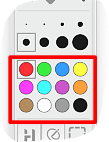
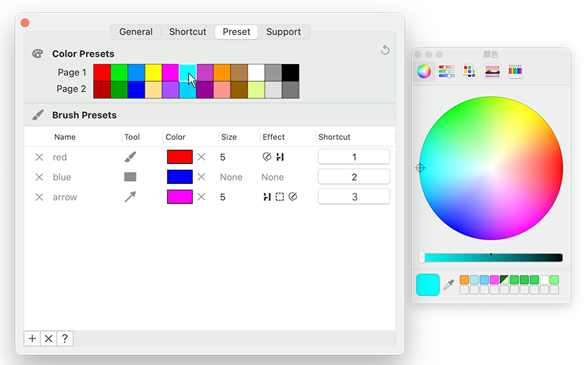
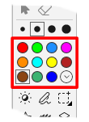
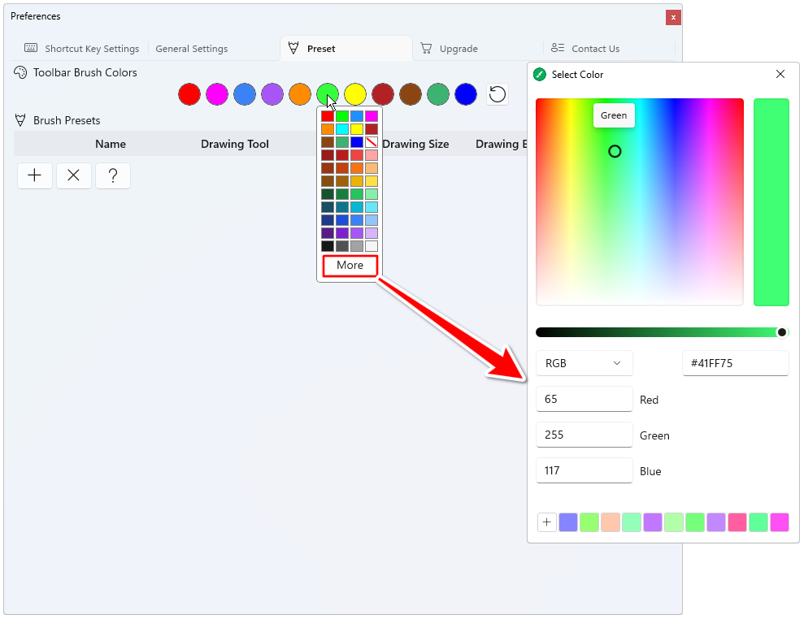
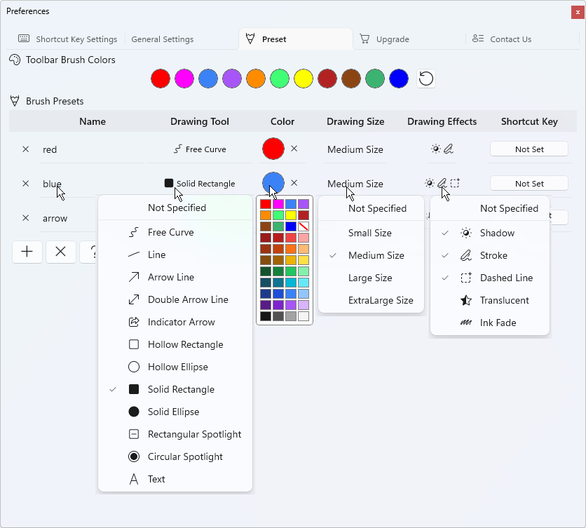
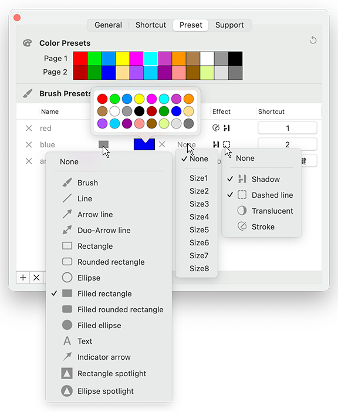
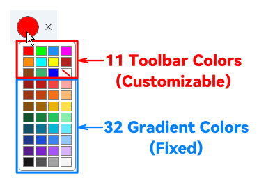

We can reset the brush colors displayed on the toolbar and make brush presets in the software's preferences.

Brush presets let you combine commonly used brush tools, colors, dimensions, and effects, and use shortcuts to quickly switch between them, eliminating the hassle of configuring them in the toolbar.

Click the gear button in the lower right corner of the toolbar to open the Preferences - Presets screen of the software, where you can define the brush color and preset brush on the toolbar.

## Toolbar color

Toolbar colors are brush colors that appear directly in the toolbar color area, and we can reset these colors as needed in our preferences.

there are some nuances in color definitions between macOS and Windows.

### macOS version

customize 24 toolbar colors for macOS. The toolbar displays 12 colors (first page) by default, and the other 12 colors (second page) are displayed after holding down the option key. You can redefine these 24 colors in the preset interface.

After clicking on the color block, a color selection dialog box will pop up, and you can set the color by clicking or entering a color value (such as RGB, Hex, etc.).

### Windows version

You can customize 11 toolbar colors for Windows. The Windows version simplifies the toolbar colors, 11 colors are provided by default, but 32 additional gradient colors are provided through the pop-up panel, and almost all colors can be used through the color selection panel using the More Colors button, but only 11 colors displayed directly on the toolbar are allowed to be customized.

Clicking the color will pop up the color panel, clicking `More` button will pop up the color selection dialog box, you can set the color by clicking or entering color values (such as RGB, Hex, etc.); click the `+` button at the bottom to record the current color into the historical color.

## Brush Presets

When editing presets, including brush tools, colors, dimensions, effects, if set to `Not Specified` or `None`, the corresponding parameters set in real time on the toolbar are automatically applied.

+ Click the `+` button to add a preset brush; Click the 'X' button to delete all presets in the table.
+ **`Name` Cell: ** Click on a cell to modify the preset name.
+ **`Drawing Tool` Cell: ** Click on a cell to modify the brush tool used in the preset; If no brush tool is specified, use the selected brush tool on the toolbar.
+ **`Color` Cell: ** Click on a cell to modify the brush color used in the preset settings; Click the `X` button after the color to clear the color; If no color is specified, use the selected color on the toolbar.
+ **`Drawing Size` Cell: ** Click on the cell to modify the brush size used in the preset; If the brush size is not specified, use the selected brush size on the toolbar.
+ **`Drawing Effects` Cell: ** Click on a cell to modify the effect used in the preset, the effect can be set to one or more; if no brush effect is specified, the effect selected on the toolbar is used.
+ **`Shortcut Key` Cell: ** Click a cell to record a preset shortcut; in Draw mode, you can use the shortcut to apply the preset configuration to the toolbar, activating the corresponding brush tools, dimensions, colors, and effects.

## Correlation of Colors and Toolbar Colors in Brush Presets

Note that the color in the brush preset is not independent, it is associated with your custom toolbar color, and when the toolbar color changes the color value, the brush color in the brush preset associated with that color will also automatically change.

However, there are exceptions for the Windows version. Because the Windows version provides not only 11 customizable toolbar colors when picking colors for the brush preset, but also an additional 32 gradient colors, which are fixed and unchangeable. When you select a color that is one of the 32 fixed colors, changing the color values of the 11 toolbar colors affects the colors in the brush preset.

