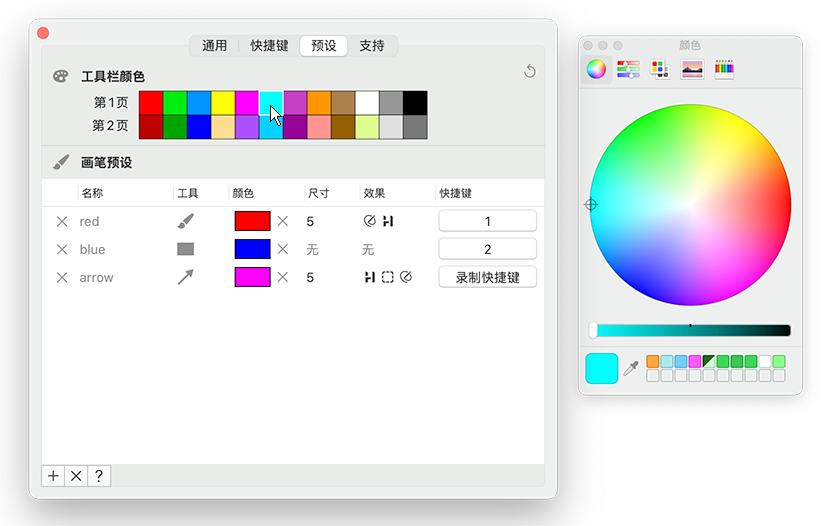
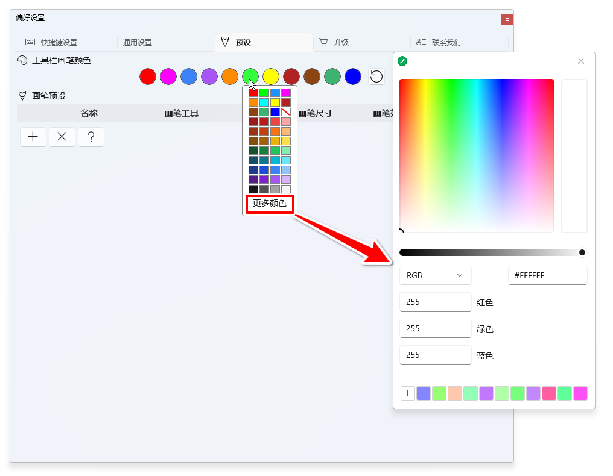
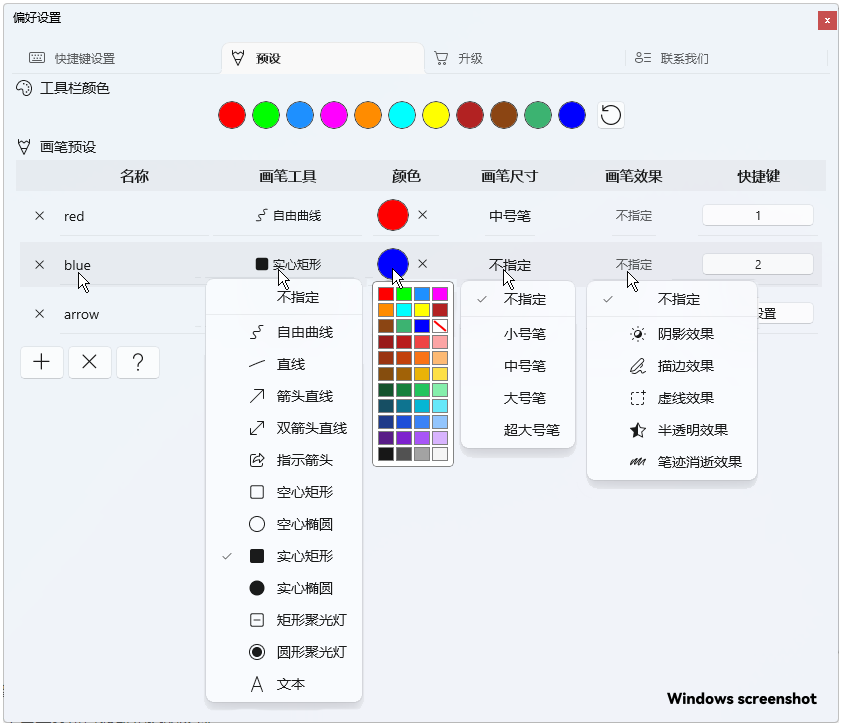
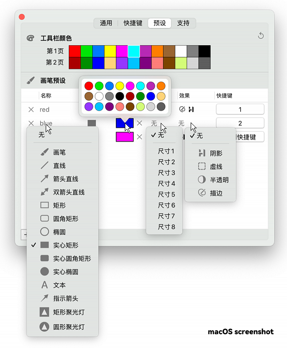
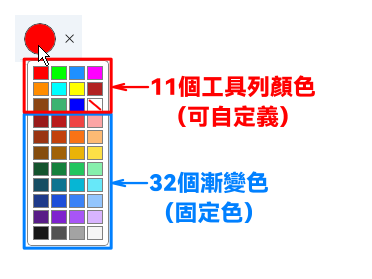

我們可以在軟體的偏好設定中重新設定工具列上顯示的畫筆顏色，以及進行畫筆預設。

畫筆預設可以將常用的畫筆工具、顏色、尺寸、效果組合，使用快捷鍵快速切換，從而省去在工具列中繁瑣的配置。

點選工具列右下角的齒輪按鈕，開啟軟體的【偏好設定- 預設】介面，這裡就可以定義工具列上的畫筆顏色和預設畫筆。

## 工具列顏色

工具列顏色指的是直接顯示在工具列顏色區的畫筆顏色，我們可以在偏好設定中根據自己需求重新設定這些顏色。

macOS版和Windows版在顏色定義上有一些細微差別。

### macOS版

macOS版的工具列顏色可自訂24個。工具列預設顯示12個顏色（第一頁），按住option鍵後會顯示另外12個顏色（第二頁），您可以在預設介面重新定義這24個顏色。

點擊色塊後會跳出顏色選擇對話框，可以透過點選或輸入色值（如RGB、Hex等）來設定顏色。

### Windows版

Windows版的工具列顏色可自訂11個。 Windows版簡化了工具列顏色，預設提供了11個顏色，但透過彈出面板額外提供了32個漸層顏色，使用【更多顏色】按鈕還可以透過顏色選擇面板使用幾乎所有顏色，但只有直接顯示在工具列上的11個顏色允許自訂。

點擊顏色會彈出顏色面板，點擊【更多顏色】會彈出顏色選擇對話框，可以透過點選或輸入色值（如RGB、Hex等）來設定顏色；點擊底部的`+`號按鈕可以將當前顏色記錄到歷史顏色中。

## 畫筆預設

編輯預設時，包含畫筆工具、顏色、尺寸、效果，如果設定成`不指定` ，則會自動套用工具列上即時設定的對應參數。

+ 点击`+`号按钮新增一个预设画笔 ；点击`X`按钮删除表格中的所有预设。
+ **`名称`单元格 ： ** 点击单元格可以修改预设的名称。
+ **`画笔工具`儲存格：** 點擊儲存格可以修改預設中使用的畫筆工具；如果不指定畫筆工具，則使用工具列上選取的畫筆工具。
+ **`颜色`儲存格：** 點擊儲存格可以修改預設中使用的畫筆顏色；點擊顏色後面的`X`按鈕清除顏色；如果不指定顏色，則使用工具列上選取的顏色。
+ **`画笔尺寸`儲存格：** 點擊儲存格可以修改預設中使用的畫筆尺寸；如果不指定畫筆尺寸，則使用工具列上選取的畫筆尺寸。
+ **`画笔效果`儲存格：** 點擊儲存格可以修改預設中使用的效果，效果可以設定一個或多個；如果不指定畫筆效果，則使用工具列上選取的效果。
+ **`快捷键`儲存格：** 點擊儲存格可以錄製預設的快速鍵；在畫圖模式下，使用此快捷鍵可以將預設中的配置套用到工具欄，從而啟動對應的畫筆工具、尺寸、色彩和效果。

## 畫筆預設中的顏色和工具列顏色的關聯性

需要注意的是，畫筆預設中的顏色它不是獨立的，它是與您自訂的工具列顏色關聯的，當工具列顏色修改了色值，那與該顏色關聯的畫筆預設中的畫筆顏色也會自動改變。

不過，對於Windows版有例外的情況。因為Windows版在供畫筆預設挑選顏色時，不僅提供了11個可自訂的工具列顏色，還額外提供了32個漸變色，這32個顏色是固定的，不可改變。當您選擇的顏色是32個固定色中的一個時，那麼修改11個工具列顏色的色值不變會對畫筆預設中的顏色造成影響。

